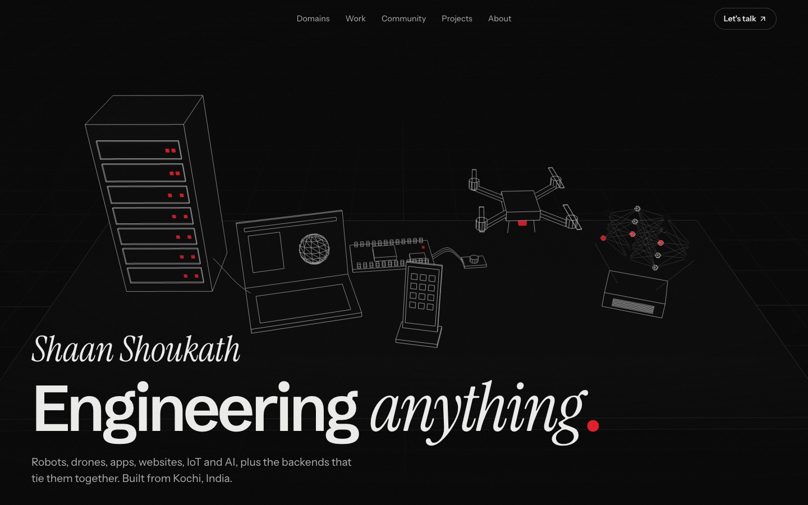
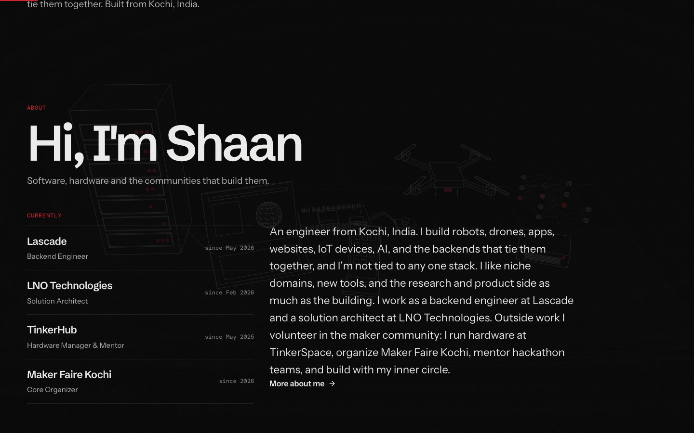
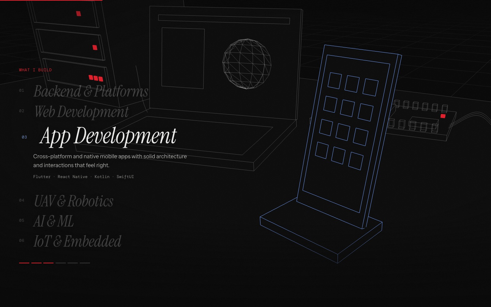
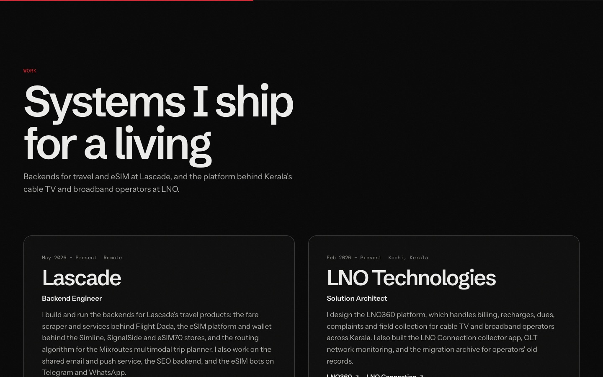
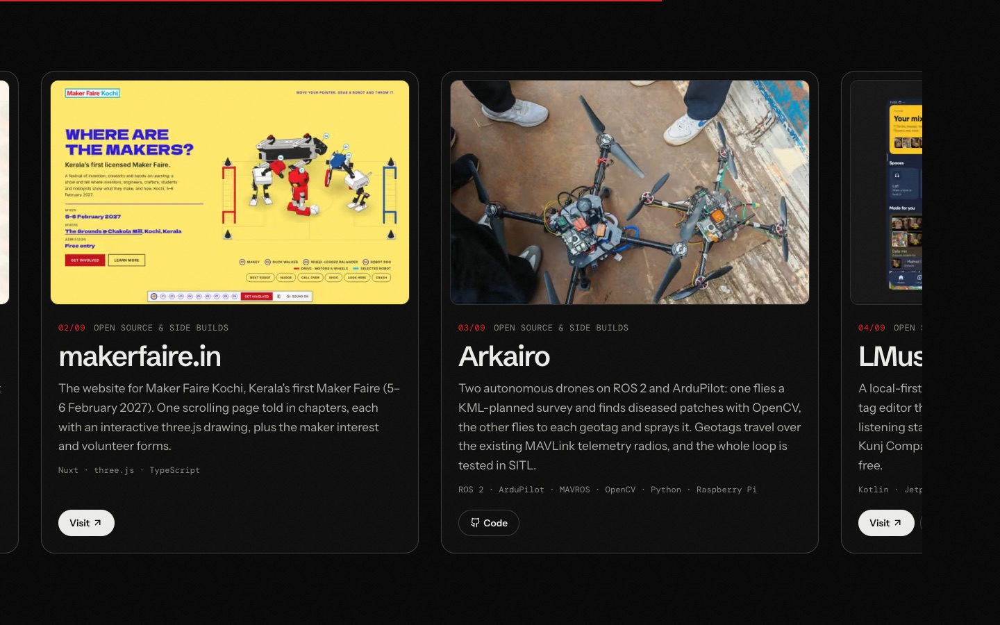
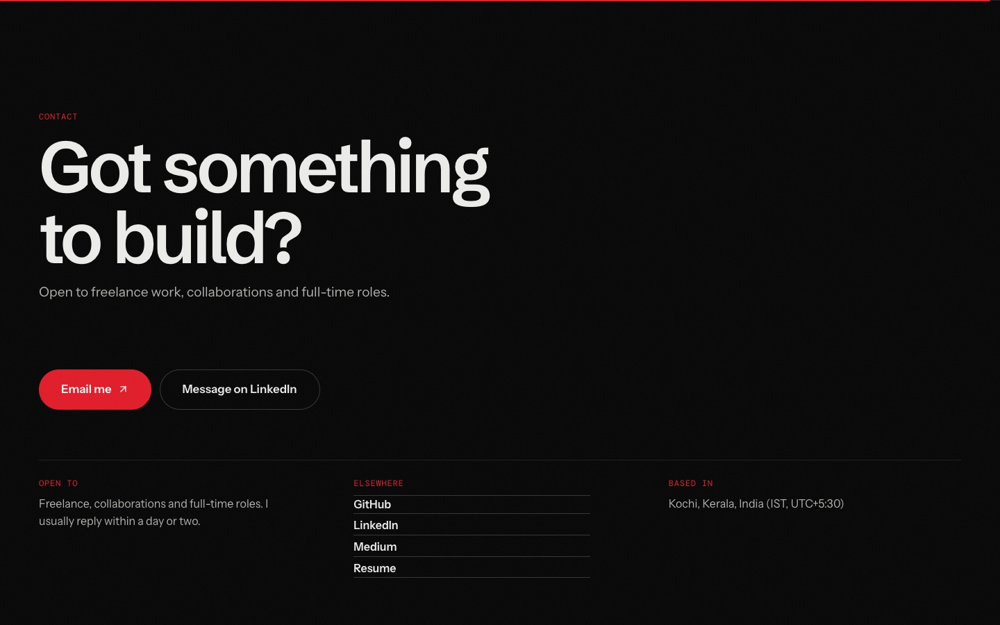
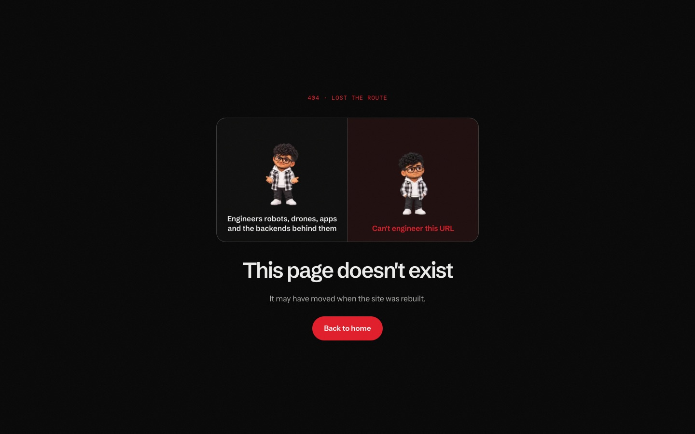
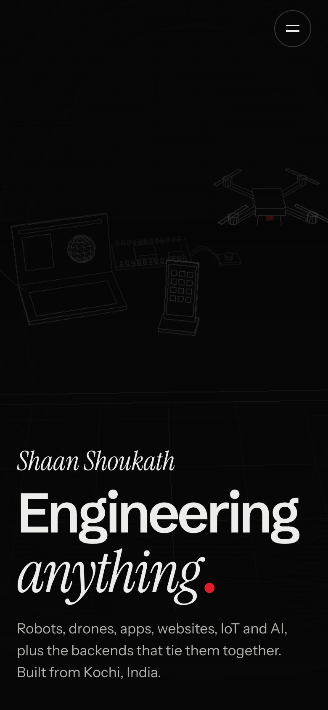

# shaans.works

My portfolio, live at **[www.shaans.works](https://www.shaans.works)**.

It isn't a grid of cards. It reads like a story: you scroll down a dark workbench, and each chapter tells you one part of what I do, from who I am to what I build, where I work, what I've shipped and how to reach me. The 3D bench, the motion and the copy all follow that one thread.



## The story, chapter by chapter

### 1. The bench: "Engineering anything."

The site opens on a blueprint-noir workbench drawn in three.js: a server rack, a laptop, a phone, a drone, an AI hologram and an ESP32 board. Each object stands for one thing I build. On a first visit, Mini Shaan (my pixel sprite) runs along a loading bar before the curtain lifts.

### 2. The intro: "Hi, I'm Shaan"

The bench dims, and the intro paragraph lights up word by word as you scroll, next to the roles I hold right now.



### 3. What I build

A pinned scrollytelling chapter. As you scroll through the six domains (backend, web, apps, UAV and robotics, AI/ML, IoT), the camera flies across the bench to the matching object and lights it up in that domain's colour.



### 4. Work and community

"Systems I ship for a living": each role with its dates, location and the products I shipped there, then the community side (TinkerHub, Maker Faire Kochi).



### 5. Projects

A horizontal gallery that scrolls sideways while the page is pinned, with a screenshot, the story and the stack for each build. On phones it becomes a swipe row. Below it, a live "On GitHub" block pulls my real contribution numbers and most active repos.



### 6. The ending: "Got something to build?"

The story closes on a contact chapter with email, LinkedIn and where to find me.



### Even the 404 tells a joke

Lose your way and Mini Shaan does it as a two-panel meme.



### Built for phones too

The bench, the chapters and the gallery all work on a phone: lighter 3D rendering, swipeable projects and full-size tap targets.



## What's under the hood

- **Next.js (App Router) + TypeScript**, server-rendered with hourly ISR, so every word is in the HTML.
- **three.js** workbench, loaded lazily and paused when it's offscreen.
- **GSAP + Lenis** for scroll motion: split-text reveals, pinned chapters, the scrubbed gallery. Everything respects reduced motion.
- **Supabase** CMS at `/admin` for domains, experience, projects and blog posts. Edits go live straight away, and the site falls back to `src/content/site.ts` when Supabase is unreachable.
- **Blog** with Markdown, images and an RSS feed at `/feed.xml`.
- **SEO and GEO**: JSON-LD, generated share cards, a sitemap, and `/llms.txt` for AI crawlers.

## Running it locally

```bash
npm install
npm run dev
```

Open [http://localhost:3000](http://localhost:3000). Copy `.env.example` to `.env.local` for Supabase, the admin account and the optional analytics and GitHub keys; without them the site still runs from `src/content/site.ts`.

```bash
npm run build   # production build
npm run lint    # ESLint
```

Screenshots in this README are from the live site (desktop at 1440×900, phone at 390×844).
